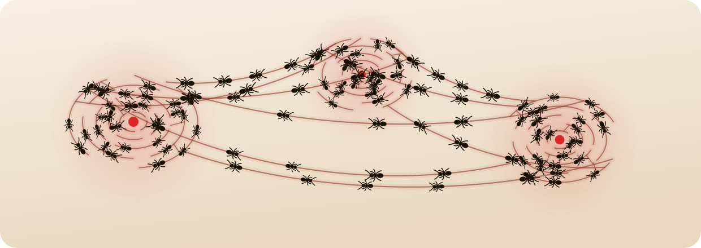

<p align="center">
  
</p>

<h1 align="center">formicaria</h1>

<p align="center">
  <em>A local-first library for research and daily life: notes, tasks, a journal, food, training, health, music and the web, kept as plain Markdown files on your own devices.</em>
</p>

---

formicaria keeps each note as one Markdown file in a folder you control, on a computer and on a
phone. There is no account and no cloud service: your devices talk to each other through git, and
to nobody else unless you ask.

A **vault** is such a folder. Running several (personal notes, a lab's notes, a paper shared with a
collaborator) is the normal case, and is what the name says: a *formicarium* is one colony's nest,
and *formicaria* is the plural.

Everything is a note of some kind. A task is a note with a status or a due date; a meal, a workout,
a song, a saved web page and a meeting are notes too. So they sit together, search together and
travel together.

## What you can do

- **Write**, in an editor that renders as you type, with links between notes (`[[`), pictures,
  formulas, diagrams and whiteboards. [Notes](docs/src/user/notes.md)
- **Start from Home**: today's journal entry, ready to write in, and the cards you choose (what is
  due, a board, figures, heatmaps), arranged as you like on a computer and kept calm on a phone.
  [Getting around](docs/src/user/getting-around.md)
- **Plan**: tasks on a board, an agenda and a calendar, reminders. [Views](docs/src/user/views.md)
- **Log food and training** against sourced diets and regimes, and keep a health diary.
  [Food and training](docs/src/user/trackers.md) · [Health](docs/src/user/health.md)
- **Keep music and videos**, saved from the web, and play them. [Music](docs/src/user/music.md) ·
  [Save media](docs/src/user/media.md)
- **Browse** in formicaria's own browser, with privacy protections, and keep any page as a note.
  [The browser](docs/src/user/browser.md) · [Privacy](docs/src/user/privacy.md)
- **Read your calendar and labelled mail** as notes, with meetings proposed for you to accept.
  [Calendars](docs/src/user/calendars.md) · [Mail](docs/src/user/mail.md)
- **Bring in** a Logseq or Obsidian folder, papers from a DOI or BibTeX, and attachments of any kind.
  [Import](docs/src/user/import.md)
- **Back up and share**: every vault is a git repository; share one with a collaborator, review
  their proposed changes, keep encrypted snapshots. [Backup](docs/src/user/backup.md) ·
  [Collaboration](docs/src/user/collaboration.md)
- **Ask a local assistant** (optional): it answers in a note's discussion, researches listed sources
  and drafts changes you review, entirely on your device.
  [The study assistant](https://formicaria-org.github.io/formicaria/manual/user/assistant.html)
- **Make it yours**: themes, layouts, and which sections you see. [Appearance](docs/src/user/appearance.md)

The whole manual is at **[formicaria-org.github.io/formicaria/manual](https://formicaria-org.github.io/formicaria/manual/)**,
and comes with every download.

## Install

**[The Get it page](https://formicaria-org.github.io/formicaria/get.html)** has one button per
device and a few plain steps.

- **Computer** (Linux, macOS, Windows): download the archive, unpack it, and double-click the
  launcher for your system (`Start formicaria.sh`, `.command` or `.vbs`). formicaria opens in its
  own browser. Later versions install from inside the app.
- **Android**: [download the app](https://github.com/formicaria-org/formicaria/releases/latest/download/formicaria-android.apk),
  open it and allow the install. [Android](docs/src/user/android.md)
- **iPhone**: an unsigned `.ipa` you sign with your own Apple ID; read
  [the iPhone chapter](docs/src/user/iphone.md) first, because that signing expires after seven days.

Nothing else is required. Some features use a tool if it is installed (git for history on Linux and
macOS, pdftotext for searching PDFs): [Configuration and optional tools](docs/src/reference/configuration.md).

<details>
<summary>Building from source</summary>

The toolchain is pinned with [pixi](https://pixi.sh); there are no other prerequisites.

```sh
pixi run serve      # build the interface, then serve it against ./vault
pixi run build      # → target/release/{fm-serve,fm}
```

The Android app: `pixi run android-init` once, then `pixi run android-release`.
</details>

## How it is built

- **Files are the truth.** One note, one file; the app's index is disposable and rebuilt from them.
- **Access is the repository.** Who can read a note is who can clone the vault it is in, never a
  field inside the file. Concurrent edits merge line by line through a frontmatter-aware merge
  driver; a real conflict is placed in the note, which still opens.
- **Local only.** The server binds `127.0.0.1`, without authentication; it is not made for a network.
- **The assistant is a separate project**, [Myrme](https://github.com/formicaria-org/myrme), linked
  by a pinned release. It can only reply or propose; it never writes to your notes by itself.

## Project status

**v0.63.7, and young.** One person's project since July 2026, built alongside their research. It
is used daily on **Linux and Android**, the only platforms checked here. macOS, Windows and iPhone
are built by CI on every release and have been reported working by other people on early versions,
but nobody here has run the current one on them.

The honest list of what is unfinished is [`docs/context/known-issues.md`](docs/context/known-issues.md);
the state of each feature is [`docs/context/features.md`](docs/context/features.md).

## Development

```sh
pixi run ci        # the single gate: format, lint, all tests, docs and the project's checks
```

Releases also pass checks in formicaria's own browser and in an Android emulator, and are published
by a tag. Start with [Getting started](docs/src/dev/getting-started.md) and
[`CONTRIBUTING.md`](CONTRIBUTING.md); [`SECURITY.md`](SECURITY.md) has the private route for
reporting a vulnerability. [`docs/context/`](docs/context/README.md) is the maintainers' working
memory: decisions and their reasons, known gaps, the queue.

```text
crates/  fm-model · fm-query · fm-core · fm-app · fm-serve · fm-cli · fm-fetch · fm-update · agent-serve
ui/      Svelte 5, compiled into the binary
browser/ formicaria's browser kit (applied to Firefox ESR)
mobile/  the Android and iPhone apps
docs/    the manual (mdBook)
```

## Licence

[MIT](LICENSE). [`THIRD-PARTY.md`](THIRD-PARTY.md) lists the licences of everything the binaries
carry.

**The Android app is distributed under GPL-3.0**, because it carries youtubedl-android (GPL-3.0) for
*Save media*. formicaria's own source stays MIT; the app's complete source is this repository. The
computer and iPhone builds are unaffected.
