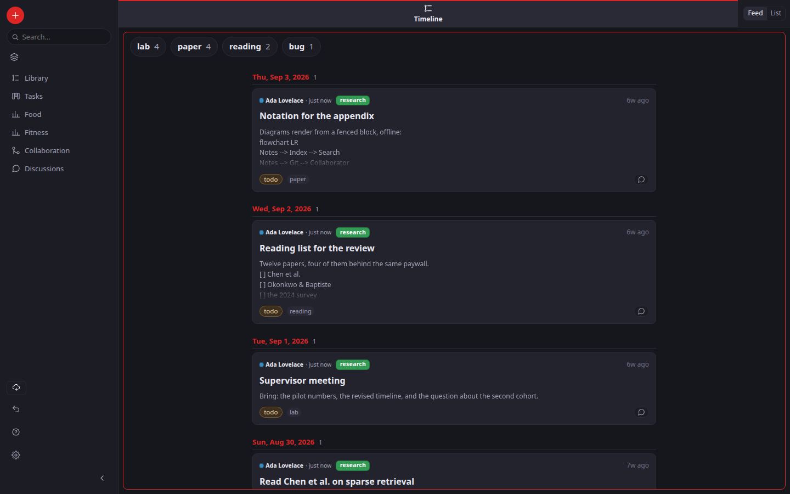

<!-- tutorial
id: 01M191H1763EX62JM1DZMBK9A9
created: 2026-10-18T00:00:05Z
This page is also a note every notebook gets, tagged `tutorial`. Edit it here, never in
crates/fm-app/src/shipped/tutorials/, then run `pixi run tutorials` (decisions.md#ui, 2026-10-24).
A copy someone has not changed is brought up to this text when they update.
-->
# Start here

This is your notebook. Everything you write in it is a **note**, and every note is a plain text file
of your own, on your device. You can open them with any other program, and they stay readable
whether this app is running or not.

## Where you are

Your notes are in **Notes**, on its **Timeline**: every note under the day you wrote it, newest
first. These short guides are notes too, tagged `tutorial`.

Tap or click a note to open it. To find one again, search: type a few words from its title or its
text. To come back here from anywhere, open the list of views (on a phone, the stacked-squares
button in the bottom bar; on a computer, the sidebar) and choose **Notes**.

## Write your first note

1. Press **＋** — at the start of the sidebar on a computer, in the bottom bar on a phone.
2. Choose **New note**.
3. Type. The first line is the title.

There is no Save button: what you type is written to the file as you go.

## The other guides

Read them in order, or whenever you need one:

- [Write, and find it again](2-write-and-find.md) — changing a note, adding a photo, searching.
- [See your notes your way](3-your-way.md) — the timeline, a board, an agenda.
- [Keep them safe](4-keep-them-safe.md) — backing up, and getting back what you deleted.
- [Ask Myrme](5-ask-myrme.md) — the assistant that runs on this device.

These guides are ordinary notes: change them, or delete them when you are done. **Help → Put the
tutorials back** brings back any you deleted. The whole manual is in **Help** too, and works without a
connection — start with [Your first ten minutes](../user/first-note.md).
