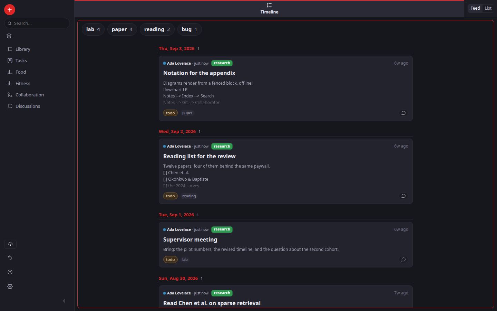
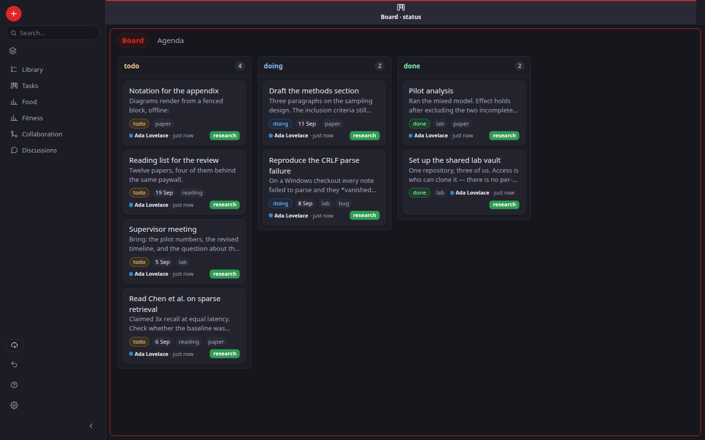

<!-- tutorial
id: 01M5JA00000000000000000T03
created: 2026-10-18T00:00:03Z
This page is also a note every notebook gets, tagged `tutorial`. Edit it here, never in
crates/fm-app/src/shipped/tutorials/, then run `pixi run tutorials` (decisions.md#ui, 2026-10-24).
-->
# See your notes your way

There is one set of notes and several ways to look at it. Nothing is copied: a view only arranges
the same notes differently. Pick one from the list of views.

## Notes: the timeline

- **Timeline** — every note under the day you wrote it, newest first. To find one, search: type a
  few words from its title, its text or its tags.

**To give a note a tag**: open it, press its **⋯ → Details**, and write the tag in **Tags** (several
tags are separated by commas). Search finds a note by its tags as well as its words.

## Tasks: a board and an agenda

Give a note a **status** (to do, doing, done) or a **date**, and it also shows up here:

- **Board** — notes as cards in columns, one per status. Drag a card to change its status.
- **Agenda** — notes with a date, on a calendar or as a list of what is due.

Set the status and the dates in the note's **Details**. Neither is required: a note without them is
still in the Library.

More in [Views](../user/views.md).

Next: [Keep them safe](4-keep-them-safe.md).
